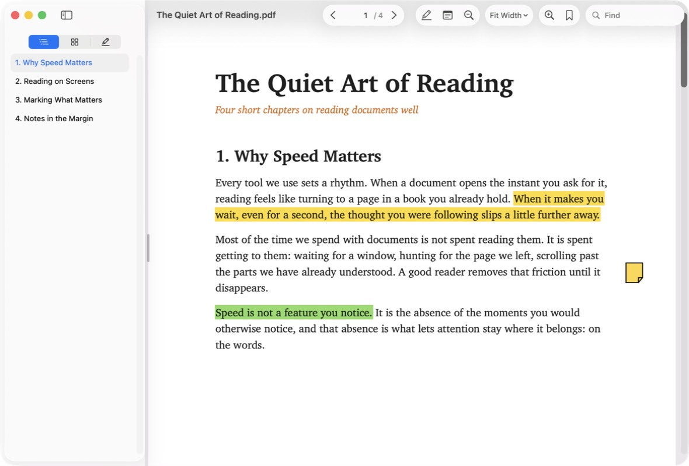
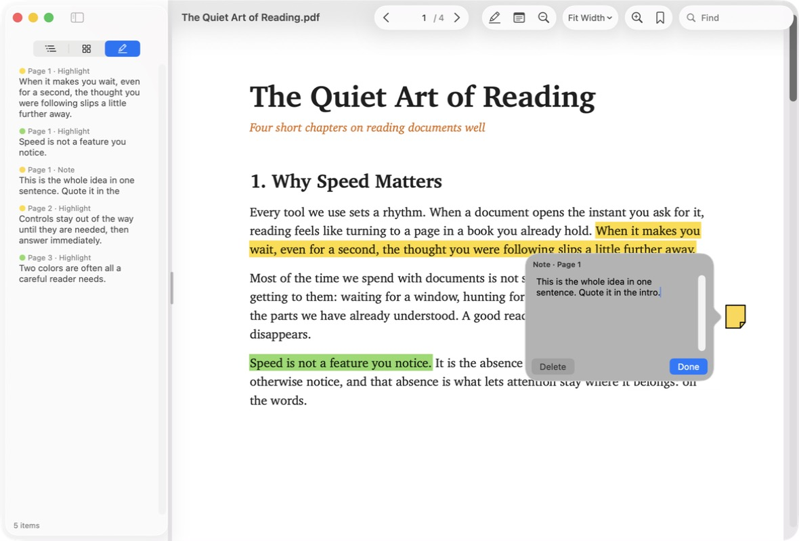
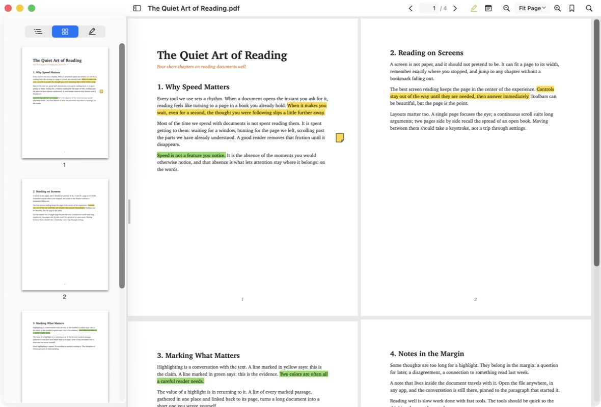

# FastPDF for Mac

A minimal PDF reader for macOS whose only goal is to feel instant. AppKit + PDFKit, no dependencies.



> **Back up PDFs you care about before annotating them.** When you save highlights or notes, FastPDF for Mac
> rewrites the whole file through Apple's PDFKit (as Preview does). That works for ordinary PDFs, but it can alter
> or drop unusual content, and it invalidates digital signatures. Reading never modifies a file.

## Requirements

- macOS 26 (Tahoe) or later on Apple Silicon. Older macOS versions and Intel Macs are not supported.
- Xcode 26 or later (or its command-line tools) to build.

There are no prebuilt downloads yet. The app is only ad-hoc signed, so build it yourself with the steps below.

## Build & install

```bash
./build.sh
```

This compiles the app, signs it (ad-hoc, sandboxed), installs `~/Applications/FastPDF for Mac.app` and registers
it with macOS. There's no Xcode project; `build.sh` calls `swiftc` directly.

To have double-clicked PDFs open here, choose **FastPDF for Mac ▸ Make FastPDF for Mac the Default PDF Viewer**
(macOS asks you to confirm once).

## Using it

| | |
|---|---|
| Pages | Page box (type a number, then Return), ‹ › buttons, ← / →, Space, Page Up / Down, Home / End, ⌥⌘↑ / ⌥⌘↓ previous / next page, ⌥⌘G go to page, ⌘[ / ⌘] back / forward |
| Layout | **D** cycles Single Page → Continuous → Two Pages, or ⌘1 / ⌘2 / ⌘3 |
| Zoom | **V** switches Fit Width ⇄ Fit Page. Also Fit Width ⌘8, Fit Page ⌘9, Actual Size ⌘0, ⌘+ / ⌘−, pinch. Fit Width and Fit Page stay in effect when the window is resized. |
| Sidebar | ⌥⌘S shows or hides it. Contents (the PDF's outline) ⌥⌘1, Thumbnails ⌥⌘2, Highlights & Notes ⌥⌘3; click any entry to jump to it. Drag the grip on the sidebar's edge to resize it; double-click the grip to reset. |
| Bookmarks | ⌘D bookmarks the current page (or removes the bookmark). The bookmark button or ⌥⌘B lists them; they're also in the Bookmarks menu. |
| Find | ⌘F, then Return or ⌘G for the next match, ⇧Return or ⇧⌘G for the previous one, Esc to close. |
| Highlights | Select text, then **H** (primary color) or **K** (secondary color). With nothing selected, H or K turns on *highlight mode*: every selection is highlighted as soon as you let go; press the same key again or Esc to stop. Choose the two colors (from six) in the **Annotate** menu. Right-click a highlight to change its color or remove it. |
| Sticky notes | **N**, then click where the note should go (with text selected, N puts the note beside it), or right-click ▸ Add Note Here. Type, then ⌘Return or click outside to finish. Click any note, including notes already in the PDF, to read, edit or delete it. |
| Undo | ⌘Z / ⇧⌘Z for highlights and notes. |
| Toolbar | **⌥⌘T** (View ▸ Glass Toolbar) switches between the standard macOS 26 glass toolbar (the default; pages scroll underneath it) and a compact title-bar row, which opens files faster. |
| Reading position | Each file reopens at the exact spot, zoom and layout you left it in, even after it's renamed or moved. |

H, K, N, V and D are single keys. They only act while the page has focus, never while you're typing in the find or
page box.

### Screenshots

Highlights & Notes in the sidebar, with a sticky note open:



The compact title-bar row (⌥⌘T) with page thumbnails and the Two Pages layout:



## Saving highlights and notes

Highlights and notes are saved into the PDF itself, so Preview, Acrobat and other apps show them too. Nothing is
written until you press **⌘S**. Until then the window's close button shows the usual unsaved-changes dot, and
closing the window or quitting asks Save / Don't Save / Cancel. To save automatically instead (about 2 seconds after
each change, and when a window closes), turn on **File ▸ Autosave Highlights**.

PDFKit can only save by rewriting the whole file, which takes several seconds for very large PDFs. FastPDF for Mac
does this in the background on a separate copy of the document, so the window never freezes while saving.

## Speed

How long it takes from asking macOS to open a PDF until its window is on screen. Measured on an M1 MacBook Air,
median of 7 runs. "Cold" means the app wasn't running; "warm" means it was.

| | Compact bar | Glass toolbar | Preview |
|---|---|---|---|
| 1-page PDF, cold | 354 ms | 487 ms | 969 ms |
| 1-page PDF, warm | 111 ms | 232 ms | 311 ms |
| 1,500-page PDF, cold | 401 ms | 534 ms | 971 ms |
| 1,500-page PDF, warm | 141 ms | 301 ms | 665 ms |

About 80 ms of every warm time is macOS delivering the open request before the app sees it.

What makes it fast:

- **It stays running** after the last window closes (like Preview), so later opens skip launching the app.
- **The compact bar avoids stock controls.** On macOS 26 the glass toolbar and standard AppKit controls render
  through SwiftUI, which is what makes the glass toolbar slower. The compact bar is drawn by hand (`ReaderBar.swift`).
- **Nothing is built until it's needed.** Sidebar panes, the highlight scan, the compact bar's search field and the
  title-bar file icon are created after the page is on screen, or on first use.
- **No extras at open:** no zoom-from-Finder animation, no window restoration, no Writing Tools menu setup at
  launch, no file-type detection.
- **The highlights list fills in on a background thread**, using a separate copy of the document.

## Known limits

- **Annotations:** you can add highlights (six colors) and sticky notes. Underlines, strike-throughs, text boxes
  and other annotations already in a PDF are displayed and listed. Underlines and strike-throughs can be recolored
  or removed, but there's no way to create them.
- **Saving rewrites the whole PDF.** It takes a few seconds for very large files, and closing a window waits for an
  in-progress save. Each save gives the file a new internal ID (FastPDF for Mac carries its bookmarks and reading
  position over), and any digital signature becomes invalid.
- **Password-protected PDFs**, and PDFs whose permissions don't allow comments, can be read but not annotated.
- **Undoing the deletion of an annotation that was already in the PDF** brings back its type, position, color and
  text, but not other details such as the original author or date.
- **Forms:** filling in PDF forms isn't supported. Anything typed into a form field isn't saved.
- **No printing.**
- **Find** is always case- and accent-insensitive, and doesn't match a phrase that's split across two lines
  (a PDFKit limitation).
- **Bookmarks and reading positions are stored on this Mac, not in the PDF.** They don't travel with the file to
  another computer, and two copies of the same PDF share them.
- **Two Pages** always pairs pages 1–2, 3–4 and so on; there's no book layout with a separate cover page.

## Tools

```bash
swift tools/make_fixtures.swift Tests/fixtures     # test PDFs: 1 page, 1,500 pages, outline + annotations
xcrun swiftc -O tools/winbench.swift -o /tmp/winbench
/tmp/winbench ~/Applications/"FastPDF for Mac.app" Tests/fixtures/big.pdf 7          # cold opens
/tmp/winbench ~/Applications/"FastPDF for Mac.app" Tests/fixtures/big.pdf 7 --warm   # warm opens
swift tools/make_icon.swift                         # regenerates Resources/AppIcon.icns
swift tools/make_sample.swift sample.pdf            # the sample document shown in the screenshots
```

The app logs its own timing for every open:

```bash
/usr/bin/log show --last 5m --predicate 'subsystem == "com.ahmadharb.FastPDF"'
```

## License

FastPDF for Mac is free software: you can redistribute it and/or modify it under the terms of the
[GNU General Public License v3](LICENSE) or (at your option) any later version. In short: anyone may use, study,
change and share it, but anyone who distributes it, modified or not, free or paid, must release the complete
source under the same license.

The GPL covers the code. The **FastPDF for Mac name and app icon are not licensed for reuse**: if you distribute a
modified version, please give it a different name and icon so it isn't mistaken for this project.
